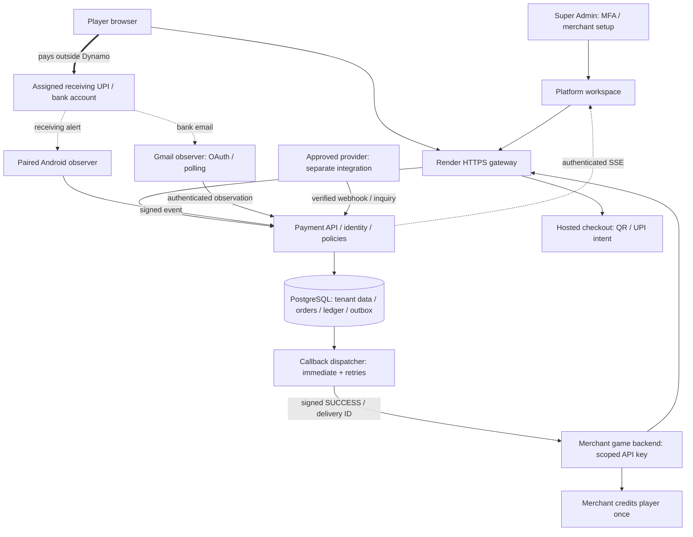

# Dynamo Pay - system design and operating manual

Prepared 1 November 2026 (Asia/Kolkata). Source `8186e32b70bd4aa90318a490b90d89a373655a9a`.

## System diagram

## Read this first

### What Dynamo Pay does

Dynamo Pay is the platform. A merchant is a separate customer business, such as a game website. The player pays into the receiving UPI chosen by platform operations. Dynamo Pay creates and tracks orders, accepts configured confirmation evidence and sends signed callbacks to the merchant backend. The game backend credits its own player wallet.

### Current release

Source baseline 8186e32b70bd4aa90318a490b90d89a373655a9a. The prior release operation verified this commit live on Render. Prepared 1 November 2026, Asia/Kolkata. Public origin: https://dynamo-pay.onrender.com. Canonical owner and merchant workspace: /platform. This document describes code behavior, not certification of a bank/provider or a completed real-phone test.

### Three different outcomes

A created checkout is not a payment. Paid/SUCCESS means the configured confirmation policy accepted the payment. Bank settlement is a separate real-world event. With notification acceptance enabled, SUCCESS is labelled NOTIFICATION and bankVerified=false; it is not labelled bank/provider verified.

### Coverage and evidence

The source inventory scans 332 tracked source/config/test files across apps, packages and scripts. The operational walkthrough follows the active hosted JavaScript entry points, platform UI, identity, collection, observer, ledger and callback code. This is a system documentation review, not a new line-by-line security certification of every historical implementation or dependency. Prior local regression: 56/56 suites, 409 tests, 238.29 seconds. No live money was moved for this document.

### Documentation precedence

Use this manual and docs/payments/RECEIVING-PHONE-MIRROR.md for the new explicit notification mode. Older README, architecture, acceptance notes and earlier PDFs contain historical notification-only-pending descriptions. Their older release dates and performance figures must not be treated as current live acceptance.

## System design and responsibilities

### Hosted boundary

scripts/start-hosted.js starts Payment API, Checkout, Merchant Console and Gmail Observer in one Render service. An HTTP gateway forwards public /v1/* and /api/platform/* requests to the API, checkout paths to Checkout, and other console paths to Merchant Console. The Gmail Observer listens privately. This is one deployment with component listeners, not four independently scaled cloud services.

### Storage

PostgreSQL is the hosted source of truth when DATABASE_URL is configured; SQLite WAL is the local development adapter. @youpi/db handles repositories, transactions and queue/slot state. The active merchant callback outbox is database-backed. Optional Redis/BullMQ/Svix code does not establish that a separate durable worker is running in this deployment.

### Trust boundaries

Browser sessions use HttpOnly cookies, CSRF checks and role permissions. Sensitive operations require MFA. Merchant API requests use a scoped bearer key, merchant ownership, expiry/revocation, optional IP restrictions and rate limits. Paired phones sign raw requests and cannot override their assigned receiving account.

### Money versus messages

The player-to-UPI arrow is the money movement. The phone/Gmail-to-Dynamo arrows carry evidence only. Dynamo-to-game is a signed callback. The ledger records accounting; it does not move money between banks. A notification-clearing entry is not a bank-cash balance or automatic settlement transfer.

### Other repository areas

apps/super-admin and apps/control-center provide auxiliary/legacy owner or local management paths; /super-admin redirects to the active workspace. apps/coin-wallet-store is demo code and the hosted launcher disables its public store/wallet routes. apps/android-bridge and parallel Kotlin sources do not prove the deployed observer APK uses those paths. Gradle for apps/android-observer-app selects the Java app; Java source is the documented phone path. Provider, refunds, payouts, settlement, banking and case-management modules exist but live use depends on their own approval, credentials and acceptance.

## Super Admin: onboard a merchant

### 1. Prepare the platform

Open https://dynamo-pay.onrender.com/platform with your platform account. Set up and verify MFA. Check that invitation/email/mobile delivery is configured, the service is healthy, and your receiving phone and UPI account are under your control. Do not distribute the platform administrator token.

### 2. Create the merchant

Open Merchant directory and create the business with its owner email, mobile and business information. Record the new merchant ID. Send the one-time owner invitation through the configured delivery flow. If delivery is unavailable, the portal can return an invitation path for controlled handover; this does not automatically verify ownership of the email/mobile.

### 3. Complete verification and review

The owner accepts the invitation, sets a password, verifies email/mobile and submits onboarding information. Review under-review records and use the supported APPROVED then ACTIVE state transitions with an audit reason. Activation checks verified owner contact details and a qualifying collection route; it is not bypassed by issuing an API key.

### 4. Assign the collection route

Select this merchant before opening Connections. Add/activate the receiving UPI account, verify its actual recipient name/bank app, configure allowed VPA/amount rules and the merchant callback URL. The configured minimum can be 0, but a payment amount must be positive and representable in paise. Other merchant/provider limits can still reject a payment.

### 5. Choose the confirmation policy

For the receiving-alert route, save Automatic notification payment acceptance for the selected receiving account with a reason. Only Super Admin can change this policy. It is off until explicitly saved. The alternate route is a genuinely approved/configured provider. Entering a UPI ID does not create Cashfree/Paytm/PhonePe credentials or activate their APIs.

### 6. Pair, activate and hand over

Pair the receiving phone as described next, then finish merchant activation. For the notification activation route, the code requires an active account, enabled policy, configured callback and an active paired phone for that UPI, in addition to owner checks. Issue the merchant-scoped production API key and deliver the integration pack securely. Finally perform a controlled genuine payment and check the callback plus game-wallet credit.

## Receiving phone, Gmail and mirror

### Pair the receiving phone

In the selected merchant Connections screen, choose Pair the assigned receiving phone. Select the account and whether optional PAYMENT_DETECTED callbacks are wanted. Scan the generated QR in the compatible Android observer. The QR expires in 10 minutes, is stored hashed, is consumed once, and is replaced by a newer pending QR for the same merchant/account.

### Phone preparation

A current signed APK built from the intended Java source is required; the old bundled APK must not be treated as current. On Vivo, allow the required SMS, notification-access and camera permissions and background/autostart operation. Keep the foreground service, network and bank/payment app notifications enabled. Do not assume latest Android compatibility until tested on the actual phone.

### What is mirrored

The server shows parsed payment evidence: receiving account, source, amount, actual extracted UTR, matched order, payment status and callback delivery. It does not stream the whole phone screen. The Java notification listener detects incoming-credit wording; it does not implement independent bank authentication. A signed device request authenticates the enrolled device, not the truth of the bank credit.

### Connect Gmail separately

In Connections & alerts, supply the platform Google OAuth client configuration, choose Connect Gmail and complete consent using the bank-alert inbox. Test the connection and confirm the receiving-account binding. Google credentials, consent and an installed observer cannot be manufactured from an email address. The current observer process has one explicitly bound inbox; independent per-merchant Gmail orchestration is not established.

### Mirror health and revocation

Open Payment mirror for the selected merchant. CONNECTED means heartbeat within 90 seconds; Java sends the first heartbeat about 5 seconds after foreground-service startup, then every 30 seconds. OFFLINE can indicate network, battery restrictions or a stopped app. Revoke a lost/replaced device in the mirror; newly pairing it creates separate device credentials. No device signing key is exposed by the mirror list.

### Offline behavior

The Java client persists up to 1,000 queued observations and flushes immediately on send and on its heartbeat loop. API connect/read timeouts are 10 seconds each. Reconnection is not a guarantee of late success: evidence still needs to fit the original eligible-order time window. A full local queue or unsupported bank alert format requires operational intervention.

## Merchant and game developer integration

### Customer handover pack

Give this customer their portal invitation/login URL, merchant ID, own production dp_live_... API secret, API base URL, webhook signing secret and this integration guide. Get their public HTTPS callback URL and optionally their backend outbound IPs. Keep Super Admin, hosting, database, receiving-device, Gmail and external-provider credentials private to their respective owners.

### API key lifecycle

In Merchant API access / Developer tools issue a production key with payments.create and payments.read. Add transactions.read or other scopes only when needed. Default key limit is 300 requests/minute and configurable from 1 to 1,000. Store the secret when shown: only its hash is retained, so it cannot be recovered later. Issuing a replacement is different from revoking/rotating a key already used by a customer.

### Create payment

POST /v1/payments with Authorization: Bearer <merchant API secret>, Content-Type: application/json and a stable Idempotency-Key. Body example: {"orderId":"deposit-1001","amount":"100.00","currency":"INR","playerReference":"player-123"}. Amount is rupees, at most two decimals; playerReference is an opaque game identifier. An omitted orderId is generated deterministically from the merchant and idempotency key.

### Display checkout and inquire

Open checkoutUrl from the response. Do not construct a PSP URL or assume a queued order has a payable QR. GET /v1/payments/{paymentId} reads status with the same merchant key. A timeout must be retried with the same key and request; changing order/idempotency identifiers can create a second payment. POST /v1/payments/{paymentId}/refresh-status exists for supported status reconciliation; it is not a force-paid endpoint.

### Handle errors

401 means missing/invalid/revoked credentials. 403 can mean scope, IP or policy denial. 409 indicates an order/idempotency/state conflict. 429 requires observing Retry-After. Provider timeouts may need reconciliation rather than another provider attempt. Read the returned error code/message and preserve your original order mapping.

### Use one API contract

The above is the preferred scoped /v1 API. Legacy /v1.0 routes have separate Client-ID / Client-Secret / Service-Id authentication and validation. Do not mix those headers with the bearer-key contract. Historical public collection creation and untracked provider aliases are retired. Payouts, refunds and bank transfers require their own enabled integrations; receiving-UPI notification acceptance does not enable them.

## Payment acceptance and state lifecycle

### Checkout slot and queue

Each receiving account has one active payment slot; the current merchant account activation path permits one active receiving account per merchant. Further orders wait in QUEUED until a slot is freed. Multiple saved UPI IDs do not prove parallel payable capacity. The default active window is 5 minutes; Payment done enters a 30-second processing window. An unresolved processing timeout moves to VERIFICATION_PENDING and frees the slot, not proof that payment failed.

### Alert success requirements

With the explicit policy enabled, the receiving mirror requires an authenticated Gmail or paired signed Android alert, incoming-credit wording, an extracted 12-digit UTR, exact amount, matching receiving UPI and exactly one eligible order. The candidate must be ACTIVE, PROCESSING or VERIFICATION_PENDING. Observed time must be within creation minus 1 second through creation plus 10 minutes and not beyond the applicable order expiry. The 10-minute cap does not extend an earlier expiry.

### Shared receiving UPI

A single platform receiving UPI can be used across merchants, but matching searches globally for the VPA and exact amount. Two simultaneous eligible orders with the same VPA/amount are AMBIGUOUS; the code refuses to guess the customer. Do not sell shared-UPI concurrent identical-amount processing as solved. Use a routing/operational arrangement that avoids that collision.

### Atomic accepted outcome

The server claims the reference, marks SUCCESS with NOTIFICATION_CONFIRMED and verification level 0, frees the slot, posts the double-entry NOTIFICATION_CLEARING / MERCHANT_RECEIVABLES journal, writes an audit entry and reserves the SUCCESS outbox delivery inside the transaction. A thrown enqueue/database error rolls back this operation. SSE/receipt publication and HTTP delivery occur afterward.

### Rejected or unresolved evidence

Duplicate alerts do not repost the ledger or callback. Reused references are REFERENCE_REUSED. Unknown/stale credits are UNMATCHED; missing UTR or disabled policy does not take the automatic-success path. Optional PAYMENT_DETECTED is PENDING only. Browser Payment done, screenshots and manually invented references cannot enter this success path.

### Other confirmation sources

A verified provider success remains PROVIDER. Separately authorized bank review remains MERCHANT. Notification acceptance remains NOTIFICATION with bankVerified=false. These labels describe different evidence; do not remove them from the game integration. A real bank credit, refund and settlement must be reconciled through the actual financial account.

## Callbacks and game-wallet credit

### Signed payload

The notification-success callback includes event=SUCCESS, status=SUCCESS, merchantId, paymentId, orderId, amount, amountPaise, currency, playerReference when supplied, actual utr/bankReferenceNumber, confirmationSource=NOTIFICATION and bankVerified=false. Callback requests include X-Gateway-Event, X-Gateway-Signature, X-Gateway-Delivery-Id and X-Gateway-Timestamp.

### Verify before processing

Compute HMAC-SHA256 over the exact raw body bytes using this merchant webhook secret. Compare sha256=<hex> against X-Gateway-Signature with a constant-time comparison. Parsing and reserializing changes the signed bytes. Match the merchant, order, expected integer-paise amount, INR currency and supported event/source before accepting the event.

### Credit once in the game database

In one durable transaction, insert the delivery ID under a unique constraint, enforce a unique credited payment/order, and credit the correct player wallet. Return HTTP 2xx only after durable acceptance. At-least-once delivery means duplicate requests are normal. Two different deliveries must not credit one payment twice. A browser redirect or PAYMENT_DETECTED must not independently trigger a wallet credit.

### First attempt and retry

The mirror requests the first delivery immediately after its database commit; its phone response does not wait for the merchant endpoint. A 5-second background sweep also processes due outbox rows. HTTP attempt timeout is 10 seconds. Default maxRetries is 5 total attempts: first try plus up to four more after delays of 5 seconds, 30 seconds, 2 minutes and 10 minutes, plus sweep/network delay. The 1-hour backoff constant exists but is not reached with the default five-attempt cap.

### Delivery monitoring

Payment operations shows attempts, response and pending/exhausted state. Failed callbacks do not reverse an accepted payment. After fixing the merchant endpoint, authorized redelivery resets the delivery attempt schedule; it still requires customer-side deduplication. Endpoint validation rejects unsafe/private destinations and redirects are not followed.

### Secret rotation

Give each merchant only its own webhook secret. Rotate under a coordinated rollout: pending deliveries are signed using the current merchant secret during retry. The consumer must know which secret to accept during the change. Never place API or callback secrets in browser JavaScript, public docs, source control or mobile pairing QR screenshots.

## Current timing, capacity and realistic expectations

### What is measured now

Three public readiness GET requests in this documentation session returned HTTP 200 in 237 ms, 103 ms, 106 ms. These include this machine-to-host HTTP behavior and connection effects. They do not measure create-payment, bank detection, callback acceptance or game-wallet credit. No live payment-to-callback p50/p95 is available.

### Configured fast path

An eligible phone alert is pushed when captured; there is no intentional extra 1-2 minute confirmation wait. Database matching and outbox commit run before the immediate delivery attempt. The portal reacts to SSE invalidation with a 250 ms debounce; if SSE is unavailable it polls every 20 seconds. These are configured intervals, not guaranteed end-to-end response times.

### Gmail and background timings

Gmail default polling is 5 seconds; active-order sweep requests can prompt extra checks, subject to authentication, overlap protection, API latency and quotas. They do not convert Gmail into real-time push. Queue/expiry recovery sweeps run every 1 second. Device heartbeat/offline windows are 30/90 seconds; these do not impose a 30-second wait on an online notification.

### Historical local benchmark

The 31 October isolated SQLite/loopback benchmark created 200 orders at concurrency 25 in 1.503 seconds, p50 156 ms and p95 297 ms: one was active and 199 queued. It used an overridden benchmark rate limit and synthetic observations. It did not prove 200 simultaneous payable checkouts or hosted payment throughput. Ten separate merchants had ten active checkouts in that synthetic run.

### Where the real delay lives

Total paid-to-wallet time = bank/app alert delay + phone capture/upload or Gmail polling + server match/commit + callback network/merchant processing + game database commit. A bank alert delayed by 1-2 minutes contributes that delay before Dynamo can act. Missing UTR, ambiguity, a sleeping host or an offline phone can leave payment unresolved instead of successful.

### Hosting and onboarding

The service plan checked for this document is Render Free. Idle sleep/cold start and single-instance resource contention prevent an immediate-callback SLA. No hosting upgrade was performed. Merchant onboarding has no measured completion time: invitation delivery, owner action, contact verification, review, phone installation and live acceptance determine it. Any minute estimate would be a planning estimate, not an observed result.

## Daily operations and troubleshooting

### Start-of-day checks

Check /_ready, portal sign-in, selected merchant, ACTIVE account state, callback configuration and receiving policy. Verify phone CONNECTED, correct UPI recipient, bank-app alerts and network. For Gmail, check consent/token and inbox/account binding. Review undelivered callbacks, unresolved orders, duplicate references and prior-day clearing/reconciliation.

### Paid at bank, still pending

Find the merchant order and compare exact amount, UPI, actual UTR and timestamps. Check phone capture/server event. UNMATCHED suggests time/account/amount mismatch; AMBIGUOUS suggests multiple eligible same-VPA/amount orders; REFERENCE_REUSED requires investigation. Do not create a fresh order or fabricate a new UTR just to obtain a green status.

### Paid in portal, wallet not credited

Check SUCCESS delivery logs and merchant HTTP response. If 401/403, confirm the webhook secret and raw-body verification. If timeout/500, repair the consumer and request authorized redelivery. If delivery is 2xx, the merchant must investigate its durable player/order mapping and wallet transaction. Never repeatedly credit by hand without reconciliation.

### Phone offline or no alert

Confirm notification access, SMS permission where used, background/autostart exemption, foreground service and internet. Test a real incoming notification format and inspect whether it carries an extractable UTR. Inspect app queue and re-pair only when appropriate. Device identity does not independently authenticate the bank app notification source.

### Finance and recovery

Reconcile notification-clearing entries to the actual bank statement and investigate gaps. Keep PostgreSQL backups and private keys outside Git. Test restore in isolation. Restart/deploy does not reverse financial side effects. Payout/refund uncertainty needs provider/bank reconciliation; do not retry with a new transfer ID. UI ledger balances are recorded accounting, not live bank balance.

### Go-live acceptance still required

Build/sign the current native APK, pair the Vivo phone, make a permitted small genuine payment, measure bank/app/ingest/commit/callback/wallet times, test duplicate and offline delivery, and reconcile the actual credit. Test independent merchant isolation and same-amount shared-UPI behavior. Google consent and genuine provider/refund/payout flows need separate acceptance. Browser screenshot QA for the new portal was unavailable; this manual is not a substitute.

## Code map and verification record

### Entry points and interface

scripts/start-hosted.js: public routing/readiness and component startup. apps/merchant-admin/public/platform.js: active workspace navigation, onboarding, keys, pairing/policy, mirror and SSE refresh. apps/payment-api/src/index.js: dependency composition, activation route checks, timers and event handling. apps/payment-api/src/platform/identity.js: users, invites, owner verification, MFA, sessions and merchant states.

### Payments and accounting

apps/payment-api/src/platform/payments.js: scoped key issuance/guard, canonical /v1 payments, callbacks and policy controls. apps/payment-api/src/services/receiving-mirror.js and platform/receiving-mirror.js: pairing, account binding, evidence matching, notification acceptance and portal endpoints. packages/db/src/repositories: sessions, slot/queue, ledger and financial persistence. packages/core/src/timing-engine.js: checkout windows and pending-state handling.

### Transport and integrations

apps/payment-api/src/routes/pollers.routes.js: signed Android/authenticated Gmail ingress. packages/core/src/webhook-engine.js: outgoing raw-body signing, durable rows, timeout and retries. apps/gmail-observer/src/gmail-poller.js: OAuth-bound inbox polling. apps/android-observer-app/app/src/main/java/com/youpi/observer: Java phone client, foreground service, receiver and notification listener. Provider adapters and confirmation code are separate from this notification route.

### Database groups

merchants/payment_receiving_accounts: recipient configuration. payment_sessions/payment_observations: order and evidence. pp_receiver_pairings/devices/policies/events/reference_claims: new receiving-phone mirror. pp_users/sessions/tokens/merchants/api_keys/audit: identity and platform scope. ledger and webhook_deliveries/provider_webhook_deliveries: accounting and durable callbacks. Logical merchant boundaries are enforced in code, not separate databases per merchant.

### Test evidence and exclusions

output/testing/regression-results.json records 56 suites / 409 tests passed at 2026-11-01T00:54:37.805Z; some external acceptance checks are conditional/skipped without their service configuration. The suite wall time is not transaction latency. receiving-mirror.test.js covers unique matching, signed pairing/ingress, tenant isolation, MFA/CSRF, duplicate and reference reuse, notification success, rollback and retry. Prior isolated PostgreSQL mirror checks covered pending-mode matching; automatic notification success has SQLite test evidence. Native/live provider/browser acceptance is separate.

### Reproducibility

SOURCE-INVENTORY-2026-11-01.csv lists scanned tracked paths, classification, line counts and hashes. Raw readiness samples: output/testing/documentation-readiness-latency-2026-11-01.json. Historical capacity samples: output/testing/capacity-results.json. This public guide contains no real API key, password, phone signing key or database credential. The generator reads source/test evidence only. Generated documents do not change production settings or enable any merchant policy.
